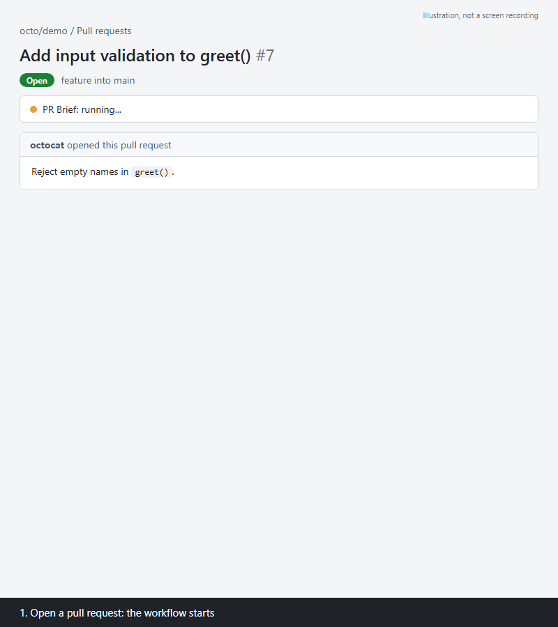

# pr-brief

A GitHub Action that writes (and keeps up to date) **one** comment on each pull request:
a short summary, a suggested Conventional Commits message, and a risk/review checklist.

## Why

Reviewers open a pull request and have to rebuild the picture from the diff. pr-brief gives them
that picture up front, in the same place every time, without a second bot comment on every push. It
works with the model you choose, including free and self-hosted ones, and it is built to fail
quietly: if anything goes wrong your pipeline stays green and the reason is in the job log.

## Quick start

1. Get an API key from a provider (for example a free key from
   [Google AI Studio](https://aistudio.google.com/)), or run [Ollama](docs/troubleshooting.md#self-hosted-runners-with-ollama).
2. In your repository: **Settings, Secrets and variables, Actions, New repository secret**. Name it
   `LLM_API_KEY` and paste the key.
3. Create `.github/workflows/pr-brief.yml`:

```yaml
name: PR Brief
on:
  pull_request:
    types: [opened, synchronize, reopened, ready_for_review]
permissions:
  contents: read
  pull-requests: write
concurrency:
  group: pr-brief-${{ github.event.pull_request.number }}
  cancel-in-progress: true
jobs:
  brief:
    runs-on: ubuntu-latest
    steps:
      - uses: mehmetalicann/pr-brief@v1
        with:
          provider: gemini
          model: gemini-3.5-flash-lite
          api-key: ${{ secrets.LLM_API_KEY }}
```

4. Open a pull request. When the job finishes there is one comment, edited in place on every push.

Optional: maintainers can ask for a new brief with a `/pr-brief refresh` comment, see
[`docs/refresh.md`](docs/refresh.md).

No `actions/checkout` step is needed. To see the result first without posting anything, add
`dry-run: true`: the comment then appears in the job log and the job summary. Model names change
over time; use one that your provider currently lists.

**Pinning.** `@v1` follows the newest 1.x release. For a stricter setup, pin the action to a full
commit SHA instead, because a tag can be moved and a SHA cannot: write `@` followed by the
40-character SHA of a release and keep the version as a comment (`# v1.0.0`). The SHA of each
release is on the Releases page, or run `git ls-remote https://github.com/mehmetalicann/pr-brief
refs/tags/v1.0.0`. Dependabot can keep a pinned SHA up to date.

### What the comment looks like



An illustration, not a screen recording: the page is drawn, the comment is produced by this
project's real renderer, and the model's answer is canned. Regenerate it with
`python scripts/make_demo_gif.py` ([how](scripts/make_demo_gif.md)). The text version:

````markdown
## PR Brief

Adds input validation to `greet()` and a test for the empty-name case.

### What changed
- `greet()` now raises `ValueError` for an empty name
- New test for the error path

### Suggested commit message
```text
fix(greet): reject empty names
```

### Risks
- 🟢 **api**: callers that passed an empty string now get an exception

<details>
<summary>Review checklist (2)</summary>

- [ ] Check callers of `greet()` for empty input

</details>
````

An illustration, not real output. The real comment also has collapsible sections for missing tests
and run details (files analysed or skipped, tokens, model, cache).

## Configuration

Set them as action inputs (`with:`) or in a `.pr-brief.yml` in your repository, which is read from
the base branch so a pull request cannot change its own settings. A fully commented example is in
[`.pr-brief.example.yml`](.pr-brief.example.yml); every value is explained in
[`docs/configuration.md`](docs/configuration.md).

| Input | Default | Meaning |
|-------|---------|---------|
| `provider` | none | `mock`, `ollama`, `openai-compatible`, `anthropic` or `gemini` ([providers](docs/providers.md)) |
| `model` | none | Model name as the provider spells it |
| `api-key` | none | Provider key, from a secret (never from a file) |
| `base-url` | provider default | Endpoint for `ollama` and `openai-compatible` |
| `language` | `en` | Language of the comment: `en` or `tr` |
| `preset` | `balanced` | Ready-made token budgets: `cheap` (3000 in / 500 out), `balanced` (6000 / 900) or `strict` (12000 / 1500); single settings still win |
| `max-input-tokens` | `6000` | Token budget for the diff |
| `max-output-tokens` | `900` | Token budget for the answer |
| `ignore` | none | Extra globs to skip, one per line |
| `include-drafts` | `false` | Also process draft PRs |
| `skip-bots` | `true` | Skip PRs opened by bots such as Dependabot (set `false` to process them) |
| `inline-comments` | `false` | Also post up to 5 review comments on the diff lines that medium and high risks are about ([how it works](docs/inline-comments.md)) |
| `allow-fork-target` | `false` | Also process fork PRs under `pull_request_target` (unsafe, read the [security model](docs/security-model.md)) |
| `dry-run` | `false` | Print instead of posting |
| `fail-on-error` | `false` | Fail the job on errors (default: stay green) |
| `config-path` | `.pr-brief.yml` | Location of the config file |
| `github-token` | `${{ github.token }}` | Token for reading the PR and writing the comment |
| `cache` | `true` | Reuse results for identical input |
| `timeout-seconds` | `60` | Per-request timeout |
| `price-input-per-million`, `price-output-per-million` | none | Your provider's prices in USD per million tokens; set both to get a cost estimate in the job summary |

### Verification status

Which provider adapters were checked against the real service, and which only against mocks of the
vendor's documented API:

| `provider` | Checked against the real service |
|------------|----------------------------------|
| `ollama` | Yes (local, `llama3.2`). |
| `gemini` | Yes (`gemini-3.5-flash-lite`, also through the README quick start on a real runner). |
| `openai-compatible` | No, mock-only: request and response shapes follow the vendor's documentation but were not called live yet. |
| `anthropic` | No, mock-only: request and response shapes follow the vendor's documentation but were not called live yet. |

If one of the mock-only adapters misbehaves, the job stays green and the log says why; please
[open an issue](https://github.com/mehmetalicann/pr-brief/issues).

## Design goals

- **Safe by default.** Runs on `pull_request` (never `pull_request_target`), never checks out or
  executes the PR's code, and skips gracefully on fork PRs that have no secrets.
- **Provider-independent.** One interface for Ollama, OpenAI-compatible APIs, Gemini and Anthropic,
  with plain HTTP and a very small dependency set (`httpx`, `pydantic`, `pyyaml`);
  see [`docs/providers.md`](docs/providers.md).
- **Cheap.** Token budgets, file filtering, map-reduce chunking and caching.
- **Never breaks your CI.** Errors produce a neutral message; the job only fails if you opt in.

How the pieces fit together: [`docs/architecture.md`](docs/architecture.md).

## Data and privacy

The diff of a pull request is sent to **the LLM provider you configure**. The project's intent is to
mask secrets and personal data before anything leaves the runner, but redaction is best effort and
cannot guarantee that nothing sensitive is sent. If your code must not reach a third party, use a
self-hosted model (for example Ollama) or do not enable the action on that repository.
Redaction, prompt hardening and output sanitising are implemented and tested; the layers and their
limits are described in [`docs/security-model.md`](docs/security-model.md).

**Free tiers.** Some providers may use data sent through their free tier to improve their models.
Google AI Studio's free tier is one example. Check your provider's current terms, and use a paid or
self-hosted model for private code.

## FAQ

**Does it run my pull request's code?** No. It reads the diff and the PR text through the GitHub
API. It never checks out or executes the PR.

**What does it cost?** The action is free. You pay your provider for tokens, if at all. The token
budgets, file filtering and cache keep this small; Ollama and free tiers cost nothing.

**Why is there no comment on a fork PR?** GitHub gives fork PRs no secrets and a read-only token
under `pull_request`, so the action skips them with a note in the job summary. See
[troubleshooting](docs/troubleshooting.md).

**Can I try it without posting?** Yes: `dry-run: true`, or locally `just run-local` (mock provider,
no network).

**Can I skip some files?** Lockfiles, build output, generated files, images and the like are
skipped by default. Add more with `ignore`.

**Which languages does it write in?** English and Turkish (`language: en` or `tr`). More are one
small dictionary away: [`docs/architecture.md`](docs/architecture.md).

**Something failed.** The job stays green and the log tells you why, with a fix. The common cases
are in [`docs/troubleshooting.md`](docs/troubleshooting.md).

## Türkçe

pr-brief, her pull request için **tek bir** yorum yazan ve her push'ta aynı yorumu güncelleyen bir
GitHub Action'dır: kısa özet, Conventional Commits biçiminde commit mesajı önerisi ve risk/inceleme
kontrol listesi.

Hızlı başlangıç için yukarıdaki iş akışını kullanın ve `language: tr` ekleyin. Başlıklar ve model
metni Türkçe olur. Yapılandırma, sorun giderme ve güvenlik belgeleri İngilizcedir.

- Kodunuzu çalıştırmaz; diff ve PR metnini GitHub API'sinden okur.
- Diff, seçtiğiniz LLM sağlayıcısına gönderilir. Gizli bilgiler önce maskelenir, ama maskeleme tam
  garanti vermez. Kodunuz üçüncü tarafa gitmemeliyse Ollama gibi kendi barındırdığınız bir model
  kullanın. Bazı sağlayıcıların ücretsiz katmanı verileri model geliştirmek için kullanabilir.
- Sorun olursa iş yeşil kalır, sebebi iş günlüğünde ve özetinde yazar
  (`fail-on-error: true` ile işi başarısız yapabilirsiniz).
- Önce denemek için `dry-run: true` kullanın: yorum yayınlanmaz, iş günlüğünde görünür.

## Security

Report vulnerabilities privately, as described in [`SECURITY.md`](SECURITY.md). Do not open public
issues for security problems.

## Development

```bash
pip install -e ".[dev]"   # or: just setup
just check                # lint + types + tests/coverage + security scans
just run-local            # offline run on a fixture diff with the mock provider
```

Tasks are defined in the `justfile` (`just --list`). See [`CONTRIBUTING.md`](CONTRIBUTING.md);
how a release is cut: [`docs/releasing.md`](docs/releasing.md).

## License

[MIT](LICENSE)
